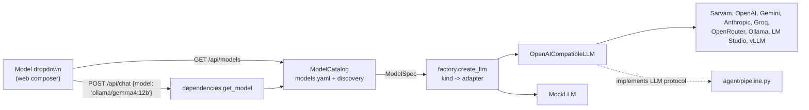

# Models, Ollama, tokens and memory

How Agentic Search chooses and calls chat models, how to run local models with Ollama, and how context size relates to memory. Measured numbers come from an Apple M3 Pro with 18 GB of memory, running Ollama 0.40.6 in October 2026.

## 1. How the API picks a model



The code lives in `apps/api/src/agentic_search_api/providers/llm/`:

| File | Role |
|---|---|
| `base.py` | `LLM` protocol (what the agent calls) and `ModelSpec` (everything needed to call one model, including its key) |
| `catalog.py` | Builds the model list from `apps/api/models.yaml`, plus live discovery |
| `factory.py` | Maps a provider `kind` to an adapter class |
| `openai_compatible.py` | One adapter for every OpenAI-compatible API, hosted or local |
| `mock.py` | Offline fake model for development and tests |

### The catalog (`models.yaml`)
- **Providers:** each provider block has a `base_url`, an optional `api_key_env`, and either a fixed list of `models` or `discover: true`.
- **Enabled when:** a provider appears only if it needs no key, or its key variable is set in the environment or `apps/api/.env`.
- **Discovery:** with `discover: true`, the API calls `GET {base_url}/models`, the OpenAI-style model list, and adds every model it returns. Results are cached for 60 s and the call times out after 3 s, so a stopped Ollama just means no Ollama models. `include` glob patterns filter discovered names.
- **Ids:** models are identified as `<provider>/<model>`, e.g. `ollama/gemma4:12b`. The browser only ever sends this id. Base URLs and API keys never leave the server.
- **Reloading:** the file is re-read on every request, so edits apply without a restart.

### Default model
The first available of:
1. `DEFAULT_MODEL` in `.env`.
2. `default_model` in `models.yaml`.
3. The first model in the list.

The mock model is listed last unless `MOCK_MODEL=false`.

### Request flow for `POST /api/chat`
1. `get_model` resolves the requested id, or the default, through the catalog. An unknown or unavailable id returns **400** before any streaming starts.
2. `get_llm` asks the factory for a fresh adapter for that model. Its calls are logged under the request's run id.
3. The agent pipeline calls only `complete_json()` (search planning) and `stream()` (the answer), so it never knows which backend it's talking to.

### What the adapter normalizes across providers
- **Streaming:** answer text is streamed to the UI. Reasoning text is counted but not shown; providers name it `reasoning` (Sarvam) or `reasoning_content`.
- **Token usage:** requested with `stream_options.include_usage`. OpenAI, Groq and Ollama only report token counts in a stream when asked.
- **Structured JSON for planning:** the adapter first asks for strict `response_format: json_schema`.
  - **Unsupported (400/404/422/501):** if the server rejects that, it retries with the schema written into the prompt and parses the reply leniently (code fences and surrounding text are tolerated). It remembers that model, so later calls skip the failing attempt.
  - **Transient errors:** the first attempt isn't retried by the OpenAI SDK, so an unsupported request costs one call instead of four. Real transient errors (408/409/429/5xx) are still retried.
- **`max_tokens`:** sent only when configured, because some local servers reject `null`.
- **Extra request fields:** passed per model via `json_extra` (planning) and `stream_extra` (answers), e.g. Sarvam's `reasoning_effort`.

### Context window and cost in the UI
- **Per-model values:** each model's `context_window` and prices come from `models.yaml`. Missing values fall back to `CONTEXT_WINDOW_TOKENS` and `PRICE_*` in `.env`.
- **Local models:** models from a `local: true` provider cost 0 unless priced explicitly.
- **Context meter:** measures the prompt tokens of the final answer call. The split into instructions, sources, history and question is estimated by character count, because providers only report a total.
- **Usage database:** every call, including failed attempts, is a row in `apps/api/data/llm_usage.db`. `response_format` in `request_params` is `json_schema` or `prompt`. Inspect it with `make usage` or `make metrics`.

### Adding a model or provider
- **Local model:** `ollama pull <model>`. It appears in the dropdown within about 60 s; reload the page.
- **Hosted, OpenAI-compatible:** uncomment or add a provider block in `models.yaml` and set its key in `.env`. No code changes.
- **Different API style** (e.g. Anthropic's native Messages API):
  1. Write an adapter with `from_spec(spec, run_id, store)` that satisfies `base.LLM`.
  2. Register its kind in `factory.ADAPTERS`.
  3. Use `kind: <name>` in `models.yaml`.

## 2. Running Ollama

### Install and upgrade
Ollama is installed with Homebrew: `brew upgrade ollama`. Newer model families need newer Ollama; pulling `gemma4` on 0.20.4 failed with **412 "requires a newer version of Ollama"**. Models in `~/.ollama/models` survive upgrades.

### Start and stop
```bash
OLLAMA_CONTEXT_LENGTH=8192 ollama serve   # start; keep the context in sync with models.yaml (see section 3)
# stop: Ctrl+C in that terminal (or quit the Ollama app)
```

### Everyday commands
```bash
ollama list                    # installed models
ollama ps                      # loaded models: memory, % GPU, context size, unload time
ollama show gemma4:12b         # architecture, max context, quantization, capabilities
ollama pull gemma4:12b         # download
ollama rm llama3.2:1b          # delete
ollama stop gemma4:12b         # unload from memory now (the server keeps running)
curl localhost:11434           # "Ollama is running"
curl localhost:11434/v1/models # the list the app discovers
du -sh ~/.ollama/models        # disk used by models
```

### Known issue: structured output
The Homebrew build of 0.40.6 runs Gemma 4 on Ollama's MLX engine, and logs `Structured output is unavailable ... libollama_xgrammar.dylib not found`. Requests with `response_format` get **501**. The app's prompt-based JSON fallback handles this automatically; see section 1.

### Heat and battery
- A loaded model holds memory until it unloads, which happens after 5 minutes idle by default (`OLLAMA_KEEP_ALIVE`).
- **Heat comes from generating, not from idling.** gemma4:12b ran the GPU flat out for about 60–70 s per long answer.
- **To cool down:** run `ollama stop <model>` to free memory while keeping the server, or stop `ollama serve` entirely.
- **Shorter keep-alive:** start with `OLLAMA_KEEP_ALIVE=1m ollama serve` so models unload sooner.

## 3. Tokens, context length and memory

### Two different numbers
| | Meaning | gemma4:12b | llama3.2:1b |
|---|---|---|---|
| **Model maximum** | What the model was trained to handle (`ollama show`) | 262,144 | 131,072 |
| **Runtime context** | What Ollama actually allocates and enforces (`ollama ps`, CONTEXT column) | 8,192 (as configured) | 8,192 |

- **Text beyond the runtime context is cut off,** so the app must use the runtime value. That's why `models.yaml` sets `context_window: 8192` for the `ollama` provider.
- **This must match how Ollama is started.** Without `OLLAMA_CONTEXT_LENGTH`, Ollama 0.40 picks a default from GPU memory, which was 4,096 on this Mac. The app's meter would then claim 8K while Ollama truncated at 4K.
- **Discovered models share one value.** The OpenAI-style model list doesn't include context sizes, so every discovered model gets the provider-level `context_window`.

### Why context costs memory
- **Weights:** fixed per model; roughly the download size.
- **KV cache:** grows with the context. Every token kept in context stores attention keys and values for every layer: about 2 × layers × kv_heads × head_dim × context_length × bytes per value.
- **Effect:** doubling the context roughly doubles the KV cache, even when a conversation uses only part of it.

Measured with gemma4:12b (7.7 GB download, nvfp4 quantization):

| Runtime context | Memory (`ollama ps`) | Processor |
|---|---|---|
| 4,096 | 8.3 GB | 100% GPU |
| 8,192 | 8.5–8.8 GB | 100% GPU |

### Memory budget on an 18 GB Mac
- **GPU limit:** Apple Silicon shares memory between CPU and GPU, but macOS caps the GPU's share. Ollama reported **13.3 GiB** available here.
- **If a model doesn't fit:** it spills partly onto the CPU. `ollama ps` then shows less than 100% GPU, and generation slows sharply.
- **The rest of the machine:** the browser, VS Code and the dev servers need the remaining memory. Budget **about 10 GB for model plus context.**

| Model | Download | On this Mac |
|---|---|---|
| `llama3.2:1b` | 1.3 GB | Very fast; too weak for good research answers |
| `gemma3:4b` / `gemma4:e4b` | 3.4 / 6.6 GB | Fast, decent |
| `gemma3:12b` / `gemma4:12b` | 8.2 / 7.7 GB | Best quality that fits; gemma4:12b tested at 8K context |
| `gpt-oss:20b` | 13.8 GB | Only with other apps closed; otherwise spills off the GPU |
| `gemma3:27b`, `gemma4:26b`, `mistral-small` | 14–19 GB | Too big |

### How many tokens a request uses
From real runs:
- **Planning:** about 150–200 prompt tokens.
- **Answer prompt, with search:** about 850–1,200 tokens. That's the system prompt and format guide, up to 10 numbered sources (titles and snippets), the history and the question.
- **Answer prompt, without search:** about 370 tokens.
- **Answer output:** 200–1,500 tokens. Reasoning models add hidden reasoning tokens on top; Sarvam used 350–6,000 per answer.
- **Long chats:** the history grows each turn, so long conversations on an 8K local model fill the window faster than on Sarvam (128K). The composer's usage meter shows how full it is.

### Choosing a context length
- **8,192:** enough for single research questions and short follow-ups.
- **16,384:** better for longer chats; costs a few hundred MB more for a 12B model.
- **Going higher:** check that `ollama ps` still shows 100% GPU.

Change both sides together:
```bash
OLLAMA_CONTEXT_LENGTH=16384 ollama serve
# apps/api/models.yaml -> providers.ollama.context_window: 16384
```

## 4. Troubleshooting

| Symptom | Cause | Fix |
|---|---|---|
| Ollama models missing from the dropdown | Ollama isn't running, or the 60 s discovery cache is stale | `ollama serve`, wait about a minute, reload the page |
| `412 requires a newer version of Ollama` | Old Ollama | `brew upgrade ollama` |
| Plan shows only the raw question | Planning call failed | Check the `search_plan` rows in the usage DB (`error` column) |
| `501 structured output is unavailable` | Runtime lacks structured output | Handled automatically by the prompt-JSON fallback |
| Answers cut off or forget earlier turns | Conversation exceeds the runtime context | Raise `OLLAMA_CONTEXT_LENGTH` and `context_window` together |
| Very slow generation, `ollama ps` below 100% GPU | Model plus context doesn't fit the GPU budget | Use a smaller model or context, or close other apps |
| `400 Model '...' is not available` | Unknown id, missing key, or model not pulled | Check `GET /api/models` |
| Laptop hot | Sustained generation on the GPU | `ollama stop <model>` or stop the server; a shorter `OLLAMA_KEEP_ALIVE` |
